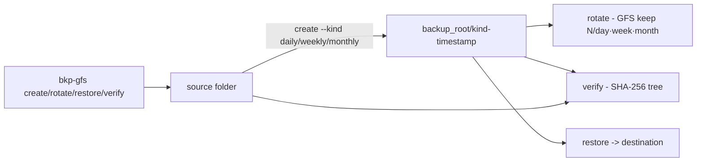

# backup-gfs-verificacao-hash

**English** · [Português (Brasil)](README.md)

[](#) [](#) [](LICENSE)

## What it is

**Backups with GFS retention and hash-based integrity checks**: it creates backups of a folder, rotates them under the **GFS policy** (grandfather–father–son: monthly, weekly, daily with configurable limits), restores them and **verifies byte by byte** against the original via the **SHA-256** of the file tree. It is an educational backup-automation lab in pure Python (stdlib).

## Status

An educational lab, working and tested (26 tests).

## Features

- **Backup** (`gfs.py`): `make_backup(source, backup_root, kind, at)` — copies the tree and records a `BackupInfo` (kind: daily/weekly/monthly, ISO 8601 timestamp).
- **GFS rotation** (`rotate`): keeps the N most recent per class (`--daily-keep/--weekly-keep/--monthly-keep`) and returns a `RotateReport` with kept/removed items.
- **Restore** (`restore(backup, destination)`).
- **Verification** (`verify(backup, original)`): compares the **SHA-256 tree** (`sha256_tree`) before declaring integrity; a `VerifyResult` reports byte-by-byte equality.
- **CLI** (`__main__.py`): `create`, `rotate`, `restore`, `verify`.

## Architecture

A `backup_gfs` package with the whole core in `gfs.py` (info/rotation/restore/hash) and the CLI in `__main__.py`. No external services: backups are local folders.



## Stack

- Python ≥ 3.10, stdlib only (hashlib, shutil)
- pytest (dev)

## Repository layout

```
backup-gfs-verificacao-hash/
├── pyproject.toml · BRIEF.md
├── src/backup_gfs/
│   ├── gfs.py         # backup/GFS rotation/hashes
│   └── __main__.py    # CLI create/rotate/restore/verify
├── tests/             # 26 tests
└── LICENSE            # MIT
```

## Prerequisites and installation

```bash
pip install -e .
```

## How to run

```bash
python -m backup_gfs create <source> <backup_root> --kind daily
python -m backup_gfs rotate <backup_root> --daily-keep 7 --weekly-keep 4 --monthly-keep 6
python -m backup_gfs restore <backup> <destination>
python -m backup_gfs verify <backup> <source>
```

## Tests and quality

Real command (verified by the agent):

```bash
PYTHONPATH=src python -m pytest tests/
# 26 passed
```

## Technical decisions and trade-offs

- **SHA-256 tree verification** (relative path + hash): catches any byte-level difference; the trade-off is re-reading the files on every check.
- **GFS with per-class limits**: predictable, cheap retention; no deduplication or compression.
- **Injectable timestamps** (`--at` ISO 8601): deterministic tests without sleeps.

## Known limitations and roadmap

- No compression, encryption or remote transfer (everything is local).
- Rotation only considers the declared backup timestamp (it does not detect out-of-band copies).

## Development process

An individual project by Kelvin Oliveira, built with orchestrated AI agents and reviewed by the author.

## License and author

MIT — Copyright (c) 2026 Kelvin Rebelo de Oliveira. Author: [Kelvin Oliveira](https://github.com/KelvinOliveiraCode) · [Portfolio](https://kelvinoliveiracode.github.io/portfolio/)
