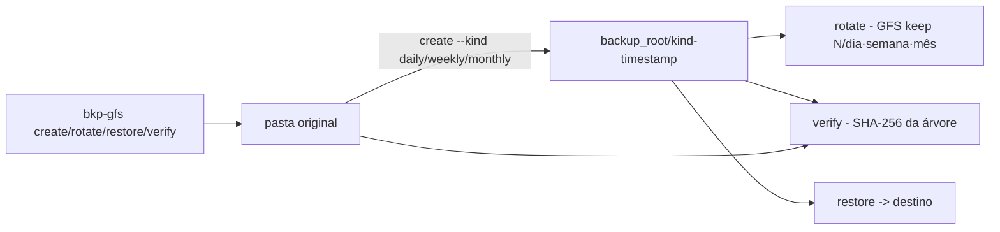

# backup-gfs-verificacao-hash

[English](README.en.md) · **Português (Brasil)**

[](#) [](#) [](LICENSE)

## O que é

**Backup com retenção GFS e verificação de integridade por hash**: cria backups de uma pasta, rotaciona pela política **GFS** (grandfather–father–son: mensais, semanais e diários com limites configuráveis), restaura e **verifica byte a byte** contra o original via **SHA-256** da árvore de arquivos. É um laboratório educacional de rotina de backup em Python puro (stdlib).

## Status

Laboratório educacional funcional e testado (26 testes).

## Funcionalidades

- **Backup** (`gfs.py`): `make_backup(source, backup_root, kind, at)` — copia a árvore e registra `BackupInfo` (kind: daily/weekly/monthly, timestamp ISO 8601).
- **Rotação GFS** (`rotate`): mantém os N mais recentes por classe (`--daily-keep/--weekly-keep/--monthly-keep`) e devolve um `RotateReport` com mantidos/removidos.
- **Restauração** (`restore(backup, destination)`).
- **Verificação** (`verify(backup, original)`): compara a **árvore SHA-256** (`sha256_tree`) antes de declarar integridade; `VerifyResult` com o resultado byte a byte.
- **CLI** (`__main__.py`): `create`, `rotate`, `restore`, `verify`.

## Arquitetura

Pacote `backup_gfs` com todo o núcleo em `gfs.py` (info/rotação/restore/hash) e a CLI em `__main__.py`. Nada de serviço externo: backups são pastas locais.



## Stack

- Python ≥ 3.10, stdlib apenas (hashlib, shutil)
- pytest (dev)

## Estrutura do repositório

```
backup-gfs-verificacao-hash/
├── pyproject.toml · BRIEF.md
├── src/backup_gfs/
│   ├── gfs.py         # backup/rotação GFS/hashes
│   └── __main__.py    # CLI create/rotate/restore/verify
├── tests/             # 26 testes
└── LICENSE            # MIT
```

## Pré-requisitos e instalação

```bash
pip install -e .
```

## Como executar

```bash
python -m backup_gfs create <origem> <backup_root> --kind daily
python -m backup_gfs rotate <backup_root> --daily-keep 7 --weekly-keep 4 --monthly-keep 6
python -m backup_gfs restore <backup> <destino>
python -m backup_gfs verify <backup> <origem>
```

## Testes e qualidade

Comando real (verificado pelo agente):

```bash
PYTHONPATH=src python -m pytest tests/
# 26 passed
```

## Decisões técnicas e trade-offs

- **Verificação por árvore SHA-256** (caminho relativo + hash): detecta qualquer diferença byte a byte; em troca, releia os arquivos a cada verificação.
- **GFS com limites por classe**: retenção previsível e barata; sem deduplicação ou compressão.
- **Timestamps injetáveis** (`--at` ISO 8601): testes determinísticos sem dormidas.

## Limitações conhecidas e roadmap

- Sem compressão, criptografia ou envio remoto (tudo local).
- Rotação considera apenas o timestamp declarado no backup (não detecta backup copiado por fora).

## Processo de desenvolvimento

Projeto individual de Kelvin Oliveira, construído com agentes de IA orquestrados e revisado pelo autor.

## Licença e autor

MIT — Copyright (c) 2026 Kelvin Rebelo de Oliveira. Autor: [Kelvin Oliveira](https://github.com/KelvinOliveiraCode) · [Portfólio](https://kelvinoliveiracode.github.io/portfolio/)
